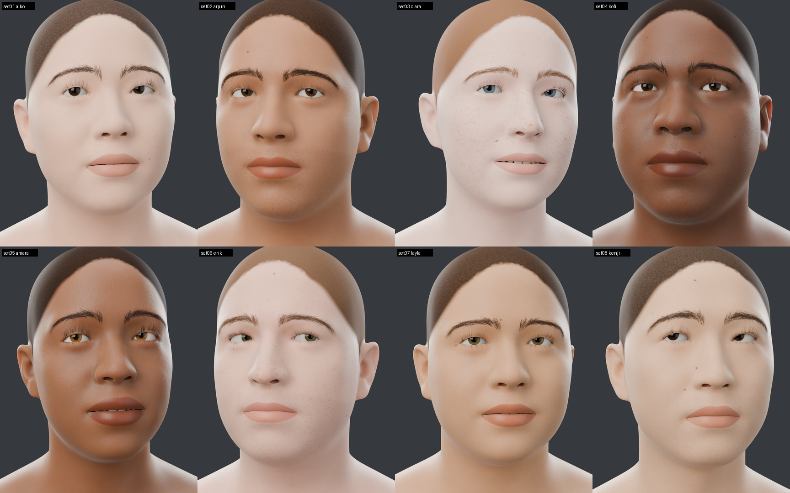

# GazeForge: photoreal textured GNM head with natural eye motion

**Samsung PRISM XR Hackathon 2026, Track 1.** Team **GazeForge**: Yuvaraj S Yali (solo), B.Tech Electronics &
Communication Engineering, Manipal Institute of Technology (MIT Manipal).

GazeForge textures and animates **Google's GNM v3 head model** without remeshing it. It uses GNM's own topology, UDIM UV
layout, identity and expression bases and its four joints (neck, head, left eye, right eye). Every texture sits directly in
GNM's UV space, and every eye, eyelid and brow movement is driven through GNM's own parameters.

[](demo/GazeForge_demo.mp4)

**▶ Demo (75 s):** [`demo/GazeForge_demo.mp4`](demo/GazeForge_demo.mp4) · **Slides:**
[`docs/GazeForge_Track1_Submission.pdf`](docs/GazeForge_Track1_Submission.pdf) ([pptx](docs/GazeForge_Track1_Submission.pptx)) ·
**Full-HD GPU render:** [](https://colab.research.google.com/github/YuvarajSYali-developer/GazeForge/blob/main/colab/GazeForge_render_HD.ipynb)

---

## Track 1 outputs: where each one is

| # | Required output (evaluation slide) | In this repository |
|---|---|---|
| 1 | 5–10 textured UV maps (face **and** eyes) wrapped directly on the GNM head | [`textures/`](textures): **8 complete UDIM sets** (GNM tiles 1001, 1002, 1004, 1006, 1007): skin 4096² (albedo, height, roughness, hair mask), **separate left and right iris/sclera 2048²**, teeth, tongue. Previews: [`textures/previews/`](textures/previews) |
| 2 | Python script that renders the output with the generated textures | [`render_stills.py`](render_stills.py) (one portrait per texture set) and [`gnm_eyes.py`](gnm_eyes.py) `--texture 01..08` |
| 3 | 5–10 rendered images with different textures | [`renders/`](renders): **8 portraits**, each a different texture set on a different GNM identity |
| 4 | Python script taking **Left / Right / Generate Motion** that renders frames and creates the video | [`gnm_eyes.py`](gnm_eyes.py) |
| 5 | Rendered videos for all 3 inputs (each ≤ 15 s) | [`videos/left.mp4`](videos/left.mp4) (6 s) · [`videos/right.mp4`](videos/right.mp4) (6 s) · [`videos/generate_motion.mp4`](videos/generate_motion.mp4) (13 s), each with a per-frame motion JSON |
| 6 | `.blend` that loads the head model and animates an expression on the Timeline (eyelids, iris, eyebrows) | [`GazeForge_GNM_Timeline.blend`](GazeForge_GNM_Timeline.blend): open it and press **Space**. It has 10 named markers. |
| + | Scene used by the scripts | [`GazeForge_GNM.blend`](GazeForge_GNM.blend) |
| + | Demo, slides, readme | [`demo/`](demo), [`docs/`](docs), this file |

## Run it

Install **Blender 4.2 LTS or newer** (Windows, macOS or Linux) and **ffmpeg**. Then, from the repository folder:

```bash
blender -b GazeForge_GNM.blend --python gnm_eyes.py -- --input Left
blender -b GazeForge_GNM.blend --python gnm_eyes.py -- --input Right
blender -b GazeForge_GNM.blend --python gnm_eyes.py -- --input "Generate Motion"
#  -> videos/<input>.mp4  (+ videos/<input>_motion.json: every animated channel, every frame)
#  With no --input the script asks: Enter input (Left / Right / Generate Motion):

# options
#   --texture 01..08        any of the 8 texture sets (identity, eyebrows and hair follow)
#   --res 1920x1080 --samples 64 --gpu      full HD on an NVIDIA/AMD/Intel/Apple GPU
#   --framing face|portrait|eyes            --fps 24        --side-convention image|subject
#   ("image", the default: Left = toward the left of the video frame)

blender -b --python render_stills.py -- --gpu        # the 8 portraits -> renders/
```

* **Timeline animation:** open `GazeForge_GNM_Timeline.blend` in Blender and press Space. Scrub the Timeline, or edit the
  keys in the Dope Sheet.
* **Windows check:** run `powershell -ExecutionPolicy Bypass -File .\tools\windows_smoke_test.ps1`. It writes previews and
  a log to `demo_run\windows\`.
* **No GPU at home?** Use [`colab/GazeForge_render_HD.ipynb`](colab/GazeForge_render_HD.ipynb), which renders everything at
  1920×1080 on a free Colab GPU.

---

## Textures (60 points: photorealism, seams, GNM UV)

Each `textures/setNN_<name>/` folder is a complete GNM **UDIM** set, named in the GNM convention `<name>.<UDIM>.png`.
Blender, Maya, USD and Mari load each set as one tiled texture.

| Tile | Region | Maps |
|---|---|---|
| 1001 | skin (face, scalp, ears, neck, inner lids, mouth) | albedo 4096², height (16-bit), roughness, hair mask |
| 1002 / 1004 | left / right eye interior: iris, pupil, sclera | albedo 2048², a **different iris for each eye** |
| 1003 / 1005 | left / right cornea | no texture needed: a clear refracting cornea shader (IOR 1.376) |
| 1006 / 1007 | teeth and gums / tongue | albedo 1024² |

* **No seams, by construction.** Every texel is rasterised from GNM's triangles back to its 3D point on the head, and all
  pigment, noise and relief fields are evaluated in 3D. Texels on both sides of a UV seam therefore get the same value.
  Discrete details are placed on the 3D surface and drawn at their exact UVs: 140 k pores, freckles, moles, beard
  follicles and eyebrow hairs. Gutters are padded, so mip-maps never bleed.
* **Anatomically placed detail**, taken from GNM's vertex groups and 68 landmarks:
  * haemoglobin redness on the cheeks, nose, ears and eyelids;
  * periorbital darkening;
  * vermilion lips with lip lines;
  * a wet caruncle;
  * an oily T-zone;
  * stubble;
  * wrinkles that scale with age;
  * a hairline.
* **Hair:**
  * **eyebrows:** 3D strands following GNM's brow landmarks in a herringbone pattern;
  * **eyelashes:** rooted on the lid-margin landmarks;
  * **short scalp hair:** 60 k strands combed along a flow field over the scalp.

  Brows and lashes are bound to the skin, so they move with blinks and brow raises.
* **Irises** are built in each eye's own polar coordinates:
  * radial stroma fibres;
  * a zig-zag collarette;
  * crypts and contraction furrows;
  * a limbal ring and pupillary ruff;
  * six colour palettes.

  The sclera has pinker canthi and conjunctival vessels.
* **Eight identities × eight skin tones.** GNM's own semantic identity decoder supplies the identities: 2 sexes × 4
  classes. Tones run from very fair to deep, each with matching eye and hair colour and an age.
* **Shading:**
  * skin: subsurface scattering with the measured mean free path of skin, 3.67 / 1.37 / 0.68 mm (Jensen 2001), and no
    scattering under hair;
  * a thin sebum coat;
  * a refracting cornea;
  * studio softbox lighting.

## Motion (20 points: coordinated eyes, eyelids, natural expression)

| Input | What happens |
|---|---|
| **Left** | The face fixates the viewer and blinks. It makes a 24° saccade to the image left, with a gaze-evoked blink. The head follows by about 25 %, with 60 ms latency, while the eyes counter-rotate. It glances further, shows a slight attentive brow lift and an interest squint, blinks again, and ends looking left. |
| **Right** | The same to the image right (different seed and identity). |
| **Generate Motion** | The face scans left and right, then makes a smooth **upward eye roll** (down-left, over the top, down-right) with raised brows, lifted lids, a head tilt and slight pupil dilation. It returns to the viewer, looks down with the **lids following the eyes** and the pupils constricting (near response) under a slight frown. It ends with a Duchenne smile in which the cheeks raise the lower lids. Blinks occur throughout. |

How the motion is built:

* **Timing.** Saccades follow a skewed gamma velocity profile fitted to the **Baloh (1975) main sequence**. Blinks close
  in **75 ms**, hold for **30 ms** and open in **150 ms**. Fixation includes drift and 0.2–0.5° microsaccades.
* **Eye–head coordination.** For large gaze shifts the head moves too, while the eyes counter-rotate (VOR).
* **Fixation geometry.** Both eyes always converge on one fixation point. Each eye rotates about its own GNM eye joint by
  the shortest-arc rotation (Listing's law).
* **Eyelid and brow controls come from GNM itself.** GNM's semantic expression decoder supplies the motion. A masked
  ridge least-squares fit in GNM's 100-component eye-region basis then isolates single actions per eye:
  * blink;
  * upper lid down;
  * upper lid raise;
  * lower lid raise;
  * brow raise;
  * brow lower.

  The blink is calibrated until the lid-margin landmarks meet (0.15 mm). The pupil uses GNM's own `pupils_000`
  component.

## Code and portability (20 points)

* [`gazeforge_gnm/gnm_model.py`](gazeforge_gnm/gnm_model.py) is a NumPy-only GNM evaluator. It matches Google's official
  `gnm_numpy` to **1.1e-7 m** with identical UDIM tiles ([`tools/check_gnm_model.py`](tools/check_gnm_model.py)).
* GNM's semantic decoders are re-implemented in NumPy, so TensorFlow is not needed.
* **Running the scripts needs only Blender and ffmpeg.** All rendering code runs inside Blender's bundled Python (NumPy
  only). It was tested on Blender 4.2 LTS and 5.0, on Linux. Windows and macOS use the same commands.
* **Rebuilding from scratch** needs `gnm_head.npz` from [huggingface.co/google/gnm-v3](https://huggingface.co/google/gnm-v3)
  and the GNM repository's landmark file:

  ```bash
  python tools/make_textures.py gnm_head.npz <GNM repo>/gnm/shape/data/landmarks/head_sparse_68.txt textures   # numpy scipy opencv-python h5py
  blender -b --python build_scene.py -- --gnm gnm_head.npz --set 02
  blender -b --python build_timeline_blend.py -- --gnm gnm_head.npz --set 03
  ```

### Repository map

```
gnm_eyes.py                 Left / Right / Generate Motion -> frames -> MP4
render_stills.py            one portrait per texture set
build_scene.py              builds GazeForge_GNM.blend from gnm_head.npz
build_timeline_blend.py     builds GazeForge_GNM_Timeline.blend (keyed expression + markers)
gazeforge_gnm/              GNM evaluator, semantic decoders, Blender rig/scene, motion, hair, textures/
assets/                     GNM expression controls (fitted), report, scalp-hair density
textures/  renders/  videos/  demo/  docs/
colab/                      full-HD GPU render notebook
tools/                      texture generation, GNM check, previews, QA checks, full rebuild script, Windows smoke test
V2_calibrated_eye_rig/      earlier validated GazeForge V2 (see below)
```

## Earlier work: GazeForge V2 (calibrated eye rig)

[`V2_calibrated_eye_rig/`](V2_calibrated_eye_rig) is the frozen GazeForge V2 release. It renders a calibrated MakeHuman
head in Blender: a camera at 40 cm, both eyeballs rotating about their own centres onto a common 35 cm fixation point,
and a 10-frame clockwise sequence with exact projected pupil labels. It passes 9/9 acceptance groups (63/63 checks), and
its labels agree with the pupils detected in the renders to within 0.26 px. The GNM submission reuses its eye-rotation
principles and its V3 temporal models. V2 is included for reference and is not part of the Track 1 outputs above.

## Limitations

* Textures are procedural. They are generated from published skin and eye properties, not scanned or photographed, and
  contain no images of real people.
* Scalp hair is a short, combed-back crop. There are no long groomed hairstyles.
* The committed videos were rendered on a 2-core CPU (960×540, 8 samples, denoised, motion blur). The Colab notebook
  renders 1920×1080 with 64 samples.
* Eyelid–cornea contact is not simulated. Gaze is limited to about ±38° horizontally and about −32° to +30° vertically.

## Licences and credits

* **GNM** (model, landmarks, semantic-decoder weights): © Google LLC, Apache-2.0. See
  [`THIRD_PARTY_NOTICES.md`](THIRD_PARTY_NOTICES.md) and [`licenses/`](licenses). The `.blend` files contain geometry
  derived from GNM; the model file itself is not redistributed.
* **V2 assets:** MakeHuman/MPFB2 CC0 (see `V2_calibrated_eye_rig/THIRD_PARTY_NOTICES.md`).
* **Everything else:** © 2026 Yuvaraj S Yali.
