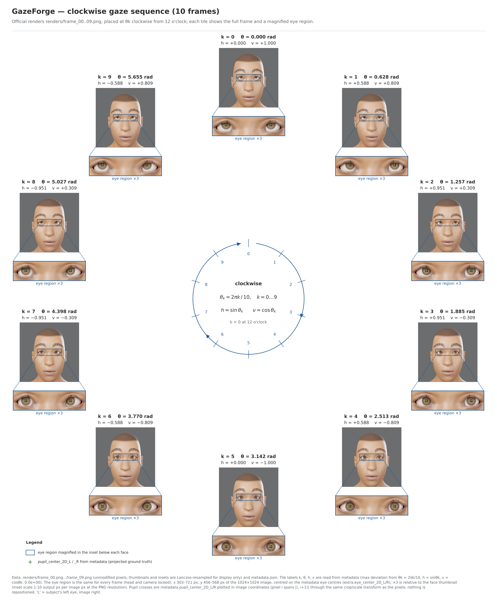

# GazeForge — Synthetic Eye Movement & Virtual Camera Rendering
**Samsung PRISM XR Hackathon 2026 · Track 1 (XR Perception Group) · Team GazeForge**

A calibrated, fully scripted binocular eye rig in Blender. A textured human head with two
anatomically placed eyeballs (sclera, iris, pupil, cornea) is driven by a Python wrapper:
`eyes.move(h, v)` turns **each eyeball about its own centre** so that both optical axes meet at a
common fixation point 35 cm in front of the eye midpoint; a camera locked 40 cm in front of the eye
midpoint renders 1024×1024 PNGs, and every frame is exported with ground-truth rotations, 2-D pupil
centres and the camera projection matrix.

## Results at a glance (measured; evidence in `reports/`)

| Check | v2 result | v1 |
|---|---|---|
| 5-direction pass/fail (Left, Right, Up, Down, Reset) | **5 / 5 PASS** on rendered pixels *and* projected ground truth | 5/5 |
| Pupil travel at full deflection | 6.73–6.90 px horizontally, 6.82 px vertically, per eye (geometry unchanged) | same |
| Reset | eye quaternions diff 0, projected pupils diff 0, re-render diff 0/255 vs neutral | same |
| Convergence | both gaze rays pass ≤ 9.4·10⁻⁸ m from the shared target in every frame | same |
| Labels vs pupils detected in the PNGs (20 pupils) | **max 0.26 px, mean 0.11 px** | 0.84 / 0.30 |
| Ground truth vs v1 (rotations, 2-D pupils, P, all frames) | **identical (max diff 0.0)** | — |
| Acceptance tests A–I on the packaged ZIP | `reports/acceptance_report.md` | 9/9 |
| Portability | scene saved by Blender 4.2 LTS; replay identical + 5/5 on 4.5 LTS and 5.0 (`reports/cross_version.md`) | same |
| Speed (2-vCPU VM, Cycles CPU, 32 spp, quality profile) | scene ready 0.17 s · **46.2 s/frame** · 10 frames 7.7 min · full run 12.4 min · peak RSS 1.6 GB | 43–89 s/frame (contended) |



### Mandatory vs. optional

| Mandatory (challenge spec) | Where |
|---|---|
| Textured articulatable face, left/right eye bones, materials | `scene.blend` (`EyeRig`, `Face`, `Eyeball/Iris/Pupil/Cornea.L/R`) |
| `eyes.move(h, v)` / `eyes.reset()` / `eyes.render()` | `wrapper/eyes.py` |
| Fixation 35 cm, camera locked 40 cm, 1024² PNG, constant lighting | §8, acceptance D/E |
| 10 clockwise frames θk = 2πk/10, h = sin, v = cos, from the top | `renders/frame_00..09.png` |
| Per-frame JSON (frame, theta, input, eye_rotation_L/R, pupil_center_2D_L/R, camera_matrix) | `metadata.json` |
| 5-direction pass/fail | `wrapper/validate_directions.py` → `reports/direction_validation.md` |
| Contact sheet or 1–2 min demo video | `renders/contact_sheet.png` (+ demo MP4 submitted separately) |
| README with setup instructions | this file, `docs/INSTALL.md`, `docs/EXECUTION.md` |

Optional additions: acceptance suite A–I, internal maths audit (`docs/audit/`), sub-pixel image
detector, quality/demo profiles, presentation boards (`reports/boards/`), cross-version check,
v2 visual refinement (lashes, conjunctiva/waterline, iris relief, brow hair strokes).

---

## 1. Problem statement (in our words)

Gaze estimators for XR headsets need very large, precisely labelled eye-image datasets covering
extreme gaze angles. Capturing them from real people is slow, expensive and constrained by privacy
regulation. A synthetic generator solves this only if (a) the eyes move the way real eyes do —
true 3-D rotation of the globe about its centre, not 2-D pupil sliding — and (b) every image comes
with exact, metrically calibrated labels. GazeForge builds such a generator in Blender and proves
both properties with automated tests that look at the rendered pixels, not just at the code.

## 2. Package layout

```text
GazeForge.zip
├── scene.blend                    head, eye bones, eye assemblies, lashes, camera, lights, calibration (textures packed)
├── wrapper/
│   ├── eyes.py                    public API: eyes.move(h, v) / eyes.reset() / eyes.render() / eyes.metadata()
│   ├── generate_sequence.py       one command: 10 frames + metadata.json + contact sheet + 5-direction test + run log
│   ├── validate_directions.py     the 5-direction pass/fail test on its own
│   ├── run_acceptance_tests.py    acceptance tests A–I (incl. running the packaged wrapper from the ZIP)
│   ├── make_boards.py             presentation boards (optional; numpy + Pillow + matplotlib)
│   ├── build_scene.py             regenerates scene.blend deterministically (Blender ≥ 4.2)
│   ├── imgutil.py, package_submission.py
│   ├── assets/head_basemesh.npz   MakeHuman CC0 head + fitted eye centres (input of build_scene.py)
│   ├── tests/v1_reference_metadata.json   v1 ground truth for the preservation check
│   └── tools/  prepare_basemesh.py · numeric_audit.py · visual_gate.py · cross_version_check.py ·
│               reproducibility_check.py · write_cross_version_report.py · make_demo_video.py · windows_smoke_test.ps1
├── renders/   frame_00.png … frame_09.png, contact_sheet.png
├── metadata.json
├── reports/   direction_validation.*, direction_test/, acceptance_report.*, run_log.json (quality), run_log_demo.json, cross_version.*, boards/
├── docs/      FINAL_REPORT.md · INSTALL.md · EXECUTION.md · BOARDS.md · audit/math_audit.md
├── THIRD_PARTY_NOTICES.md
└── README.md
```

## 3. Requirements

* **Blender 4.2 LTS or newer** (scene saved with 4.2.23 LTS), CPU Cycles. No add-ons, no internet, no GPU.
* *Or* the official `bpy` module from PyPI on **Python 3.11** (`pip install "bpy==4.2.*"`).
* Optional: `pip install numpy pillow matplotlib` for `make_boards.py`.

Details and the tested-environment matrix: `docs/INSTALL.md`.

## 4. Quick start

From the unzipped package root (the folder containing `scene.blend`):

```bash
# Linux / macOS
BLENDER=blender
"$BLENDER" -b scene.blend --python wrapper/generate_sequence.py              # official outputs (quality, 32 spp)
"$BLENDER" -b scene.blend --python wrapper/generate_sequence.py -- --demo    # fast live demo -> demo_run/
"$BLENDER" -b scene.blend --python wrapper/validate_directions.py            # 5-direction test only
"$BLENDER" -b scene.blend --python wrapper/eyes.py -- --move -1 0 --out /tmp/left.png
```

```powershell
# Windows PowerShell
$BLENDER = "C:\Program Files\Blender Foundation\Blender 4.2\blender.exe"
& $BLENDER -b scene.blend --python wrapper\generate_sequence.py
& $BLENDER -b scene.blend --python wrapper\generate_sequence.py -- --demo
& $BLENDER -b scene.blend --python wrapper\validate_directions.py
powershell -ExecutionPolicy Bypass -File wrapper\tools\windows_smoke_test.ps1
```

With the `bpy` module: `python3.11 wrapper/generate_sequence.py [--demo]` (same options, no `--`).

**Profiles.** The default *quality* profile (32 samples, stored in `scene.blend`) writes the official
`renders/`, `metadata.json`, `reports/`. `--demo` (8 samples) writes only to `demo_run/`.
`--samples N` is accepted only with `--demo` or `--out DIR`; a below-quality run that would write
into the package root is refused (exit 2, also through a symlink). Ad-hoc renders (`eyes.render()`
without a path, `eyes.py` without `--out`) go to `demo_run/renders/`, and `eyes.render()` refuses to write
`renders/frame_NN.png` — only a quality run of `generate_sequence.py` rewrites the official frames.
More commands (boards, acceptance, packaging): `docs/EXECUTION.md`.

## 5. Python API

```python
import sys; sys.path.insert(0, "wrapper")
import eyes

eyes.reset()                    # calibrated neutral: both eyes converge on the 35 cm target
eyes.move(-1.0, 0.0)            # look LEFT (image left) — raises on |h|,|v| > 1, NaN, inf, strings, None, bool
eyes.move(0.0, 1.0)             # look UP
png = eyes.render("up.png")     # synchronous Cycles render → absolute path of the 1024×1024 PNG
rec = eyes.metadata()           # ground truth for the current pose (metadata.json record fields minus frame/theta)
```

| Call | Behaviour |
|---|---|
| `eyes.move(h, v)` | Validates inputs, computes the target, rotates each eye bone by its own shortest-arc quaternion about its own centre, moves the `FixationTarget` empty, evaluates the depsgraph before returning. Returns per-eye yaw/pitch, vergence, gaze-ray miss distance. |
| `eyes.reset()` | Restores head, camera (pose and intrinsics), lights, world strength and resolution exactly to their values at load, then `move(0, 0)`. Repeated resets give bit-identical quaternions. |
| `eyes.render(path=None)` | Refuses to render if camera, lights, head or resolution changed since load (call `reset()` to recover). Writes an RGB PNG (default `demo_run/renders/render_NNNN.png`), returns its absolute path, keeps `eyes.get().last_metadata` for exactly that pose. |
| `eyes.metadata()` | `input`, `eye_rotation_L/R`, `pupil_center_2D_L/R`, `camera_matrix` + an `extra` block (§10). |
| `eyes.Eyes(**overrides)` | Class interface; calibration constants can be overridden, e.g. `eyes.Eyes(max_offset_h_m=0.04)`. |

If `scene.blend` is not open, the wrapper opens `../scene.blend` (relative to `wrapper/`) or `$EYES_SCENE`.

## 6. Scene configuration

| Object | Role |
|---|---|
| `EyeRig` (armature) | bones `head`, `eye.L`, `eye.R`; each eye bone's head is the eyeball rotation centre, its +Y axis the primary-position optical axis. Holds `calibration_json`. |
| `Face` | MakeHuman head (4 483 verts, quads, subdivided ×2 at render), spherical UV layout, 4096×2048 procedural albedo + hair mask, SSS skin. A per-vertex `socket` attribute (1 on the inner lid / orbital surface that faces the eyeball) blends a wet pink conjunctiva shader for the caruncle, waterline and tear film. |
| `Eyeball.L/R` | sclera sphere r = 12.5 mm without the corneal cap; textured (tint variation, vessels), wet coat |
| `Iris.L/R` → `Pupil.L/R` | iris annulus r = 5.9 mm, 2K procedural texture + height map (bump only); pupil disc r = 2.0 mm. **The pupil object's origin is the 3-D pupil centre** used for the 2-D labels. |
| `Cornea.L/R` | spherical cap, radius of curvature 7.8 mm, apex 13.7 mm from the rotation centre; transparent + specular, **non-refracting** (§15.3) |
| `Eyelashes` | 2×(160 upper + 60 lower) tapered strands, static on the `head` bone, rooted on the lid margin *as seen by the camera* (ray-cast) and growing forward/outward — they never enter the eye aperture in the image |
| `RenderCamera` | 62 mm lens, 36 mm sensor, 1024×1024, transform-locked |
| `KeyLight`, `FillLight`, `RimLight`, world | fixed area lights + uniform grey world |
| `FixationTarget` | empty (not rendered) at the current fixation point |

Rendering: Cycles CPU, 32 samples, OpenImageDenoise, seed 0, no adaptive sampling, Filmic view
transform, persistent data. Hierarchy `EyeRig.eye.L → Eyeball.L → {Iris.L → Pupil.L, Cornea.L}`
(same for R): rigid, moved only by the eye bone's rotation.

## 7. Coordinate conventions

* **World**: Blender world, metres, Z up. The head faces **−Y**. **+X is the subject's left.**
* **Eye labels**: `L` = subject's anatomical **left** eye (world +X), on the **right** half of the
  image; `R` = anatomical right eye, image left.
* **Gaze inputs**: `+h` → target and pupils move towards the **image right**; `+v` → **up**.
  Verified on rendered images (tests F, G).
* **Image coordinates**: continuous pixels, origin at the **top-left image corner**, x right, y down;
  pixel *i* spans [i, i+1), so pixel centres are at *i* + 0.5 and the image centre is (512, 512).
  **OpenCV users:** OpenCV puts pixel centres on integers — subtract 0.5 from x and y (equivalently
  cx = cy = 511.5) or you get a +0.5 px bias.
* **Eye rotations** (`eye_rotation_L/R`): world-frame rotation of each eyeball from its primary
  (straight-ahead) position, Euler angles in radians, Blender order `XYZ` (R = Rz·Ry·Rx, X applied
  first; same as SciPy `from_euler('xyz', …)`). rx < 0 = gaze up, rz > 0 = gaze towards image
  right; ry is a by-product of the XYZ decomposition (≤ 0.55°), **not** ocular torsion.
  Quaternions (w, x, y, z) are also exported in `extra`.

## 8. Calibration methodology

1. **Eyeball centres** `C_L`, `C_R`: least-squares sphere fit to MakeHuman's `helper-l-eye` /
   `helper-r-eye` geometry — the position MakeHuman's lid topology is built around. IPD 58.67 mm.
2. **Eye midpoint** `M = (C_L + C_R)/2` — the calibration reference.
3. **Head frame**: forward f = −Y, image-right r = +X, up u = +Z (stored; re-derived from the live armature).
4. **Nominal fixation** `F0 = M + 0.35 m · f`.
5. **Camera**: optical centre at `M + 0.40 m · f`, looking along −f, up = u; M projects to (512, 512).
   *Distance convention*: 0.40 m is the distance from the camera's projection centre to the eye
   midpoint along the head's forward axis (the fixation target is 5 cm in front of the camera centre).
6. **Motion bound (configurable)**: the ±5 cm bound applies to the **fixation target**, per axis, in
   the plane through F0 perpendicular to f: `T = F0 + h·0.05·r + v·0.05·u`. Result: ±8.10° elevation;
   horizontally up to 12.77° adduction and 3.38° abduction per eye (left eye −12.8°…+3.4°, right eye
   −3.4°…+12.8°; the converged eyes start 4.79° inwards, vergence 9.58°). Parameters
   `max_offset_h_m`, `max_offset_v_m`, `fixation_distance_m`.
7. **Intrinsics**: f = 62 mm on a 36 mm sensor → fx = fy = 1763.56 px, cx = cy = 512 (corner-origin,
   see §7), no skew, no distortion.
8. `EyeRig["calibration_json"]` is the single source of truth; the wrapper refuses to run if the live
   eye centres or camera disagree with it by more than 10 µm.

## 9. Gaze mathematics

For each eye independently:

```
T       = F0 + h·0.05·r + v·0.05·u            common fixation point
d_eye   = (T − C_eye) / |T − C_eye|           desired optical axis
a_eye   = primary-position optical axis (bone +Y in world)
q_world = shortest-arc quaternion a_eye → d_eye
q_bone  = q_rest⁻¹ · q_world · q_rest         the same rotation expressed in the bone's rest frame
pose_bone.rotation_quaternion = q_bone        rotation about the bone head = eyeball centre
```

**Torsion and Listing's law (audited).** The shortest-arc rotation from a fixed straight-ahead
primary position has its rotation axis in the plane perpendicular to that primary direction
(Listing's plane); numerically every applied axis lies in it to 4·10⁻⁸. This is the **monocular**
Listing's law (L1): zero torsion *in Listing coordinates*; expressed as Fick/Helmholtz angles the
same orientations show up to ≈0.55° of "false torsion", as expected. The **binocular** extension
(L2: Listing's planes rotate temporally with vergence, cyclovergence at near fixation — Mok et al.
1992; van Rijn & van den Berg 1993) is **not modelled**; scaled from Mok et al., the omitted
cyclovergence is about ±0.4° at v = ±1. Details: `docs/audit/math_audit.md`.

Convergence is geometric: after each `move()` the wrapper measures the distance between the target
and each eye's actual (post-depsgraph) gaze ray: ≤ 9.4·10⁻⁸ m in every frame.

## 10. Metadata (`metadata.json`)

One record per frame, field names as in the brief, plus `extra`:

```json
{"frame": 3, "theta": 1.8849555921538759, "input": {"h": 0.9510565162951536, "v": -0.30901699437494734},
 "eye_rotation_L": [rx, ry, rz], "eye_rotation_R": [rx, ry, rz],
 "pupil_center_2D_L": [x, y], "pupil_center_2D_R": [x, y],
 "camera_matrix": [[…4…], […4…], […4…]], "extra": {…}}
```

* `camera_matrix` — the **3×4 projection P = K [R | t]** (camera axes x right, y down, z forward).
  `[x, y, 1]ᵀ ∝ P [X, Y, Z, 1]ᵀ` gives `pupil_center_2D_*` in the corner-origin pixel convention of §7.
  `extra` also has `camera_intrinsics_K`, `camera_extrinsics_Rt_world_to_camera`, `camera_to_world_blender`.
* `pupil_center_2D_*` — projection of the 3-D pupil centre (`extra.pupil_center_3D_*`). The cornea
  does not refract, so this is where the pupil is imaged; `extra.qa` holds the pupil detected in the
  PNG and its distance to the label.
* `extra` also: eyeball centres (3-D/2-D), eye midpoint, fixation target, gaze directions, yaw/pitch
  (deg), vergence, gaze-ray miss, quaternions, image path, render profile and sample count.

All values are read from the evaluated scene after `move()`; none are hard-coded or "intended".

**Note on the brief's sample record.** Slide 7 shows frame 3 with `v = 0.309`; with v = cos θ the
value for θ₃ = 1.885 is **−0.309** (+0.309 belongs to frame 2). We follow the equations.

## 11. Validation

All produced by scripts in `wrapper/`, saved under `reports/`.

**Image detector.** Each pupil is found in the PNG without using its label: dark-blob centroid
inside a circular ROI centred on the *static* projected eyeball centre, then sub-pixel refinement —
edge points along 120 rays, each with its own half-way threshold, and a trimmed least-squares circle
fit (70 % best rays), so a lid shadow, lash or glint on one side cannot drag the centre. (v1 used the
blob centroid only, which the lid shadow biased by up to 0.84 px in up-gaze; method adopted from the
internal maths audit.)

**Five-direction test** (`reports/direction_validation.md`, `reports/boards/direction_board.png`).
Both measurements (projection and image detection) must move the expected way by ≥ 2 px with
off-axis drift < 50 %; a wrong sign fails. RESET calls `reset()` 3× after an arbitrary move.

| Test | Left eye (proj / det, px) | Right eye (proj / det, px) | Status |
|---|---|---|---|
| LEFT (−1, 0) | dx −6.73 / −6.84 | dx −6.90 / −6.95 | PASS |
| RIGHT (+1, 0) | dx +6.90 / +6.93 | dx +6.73 / +6.81 | PASS |
| UP (0, +1) | dy −6.82 / −7.00 | dy −6.82 / −7.05 | PASS |
| DOWN (0, −1) | dy +6.82 / +6.88 | dy +6.82 / +6.92 | PASS |
| RESET | 0 px, 0 rad | 0 px, 0 rad, re-render diff 0/255 | PASS |

Horizontal travel differs between eyes because the converged eyes start 4.79° inwards (abduction
vs adduction) — real binocular geometry.

**Acceptance tests A–I** (`reports/acceptance_report.md`): integrity of the *saved* scene; API incl.
invalid inputs; articulation (centres never translate, rigid assemblies, head untouched); convergence
and bounds; camera calibration; 5-direction re-measured from the saved PNGs; sequence (equations,
frame 0 at top, pupils measured in the images trace the clock); metadata (every rotation and pupil
re-derived independently in numpy); **preservation** (ground truth identical to v1); packaging (the
ZIP is extracted and its wrapper run in a fresh interpreter, reproducing `metadata.json`).

**Internal maths audit** (`docs/audit/math_audit.md`, re-runnable with
`wrapper/tools/numeric_audit.py <package>`): target geometry, centres, rotations, quaternion
conjugation, K/R/t/P, pixel convention, pupil projection, Listing's law — no maths discrepancies;
documentation corrections applied in this README.

**Cross-version**: replay of all 10 poses identical and 5/5 on Blender 4.5 LTS and 5.0 (`reports/cross_version.md`).

**Not tested by us**: a Blender *executable* and **Windows**. Everything ran headless on Linux with
the official `bpy` builds (same Blender code). `wrapper/tools/windows_smoke_test.ps1` performs that
check in ~5 minutes on any Windows PC with Blender installed.

## 12. Performance (measured, `reports/run_log.json` and `reports/run_log_demo.json`)

2 vCPU cloud VM, Cycles CPU, Blender 4.2.23 LTS (`bpy`), Python 3.11.18:

| Profile | Samples | Scene ready | Per frame | 10 frames + metadata | 5-dir validation | Total | Peak memory |
|---|---|---|---|---|---|---|---|
| quality (official) | 32 | 0.17 s | 46.2 s (44.4–48.0) | 463 s | 276 s | 743 s | 1.6 GB RSS (Cycles 322 MB) |
| demo (`--demo`, writes `demo_run/`) | 8 | 0.18 s | 18.8 s (18.3–19.5) | 189 s | 113 s | 306 s | 1.6 GB RSS (Cycles 322 MB) |

Labels never depend on the sample count; a typical 8-core workstation is several times faster.

## 13. Visual refinement in v2 (ground truth unchanged)

Every change was gated by `wrapper/tools/visual_gate.py`: the candidate scene must give **bit-identical
ground truth** to v1 for 15 poses, image-vs-label ≤ 1 px, unchanged pupil area (no occlusion) and
correct directions. Changes: conjunctiva/caruncle/waterline shader on the inner lid surface (removes
the dark voids at the eye corners); 2K iris with radial stroma, crypts, furrows, collarette, soft
limbal ring and bump relief; off-white sclera with tint variation, finer vessels and micro-bump;
eyelashes; eyebrows as ~750 hair strokes per brow lying in the skin's tangent plane; finer scalp
stubble. Eye geometry, rotation centres, camera, lights and the face mesh are unchanged.
Before/after: `reports/boards/eye_detail_before_after.png`.

## 14. Asset provenance & licences

MakeHuman / MPFB2 base mesh, macro and eyelid targets and region masks: **CC0 1.0**; all other
textures generated by `build_scene.py`. No MPFB code is used. Full list: `THIRD_PARTY_NOTICES.md`;
derivation: `wrapper/tools/prepare_basemesh.py` (eyelid targets `eye-height1/2-incr` at **0.8**).

## 15. Known limitations

1. **Gaze amplitude follows the spec literally.** ±5 cm at 35 cm gives ≈ 7 px of pupil travel at
   1024² — clearly measurable and validated on pixels, but subtle full-frame; the boards show
   labelled magnified insets. Larger ranges are one parameter away (`max_offset_*_m`).
2. **Static eyelids.** Real upper lids follow vertical gaze. At v = +1 the upper lid edge stays
   ≈ 15 px (≈ 3.4 mm) above the pupil's top edge, so nothing is occluded. Lid-follow (shape keys
   driven by eye elevation) was investigated and **not** enabled: it would deform the face per frame
   and break the "head never moves or deforms" invariant tested in C.
3. **Non-refracting cornea (deliberate).** The geometric pupil centre is exactly where the pupil is
   imaged, so labels are exact. A real cornea shifts/magnifies the apparent pupil; adding refraction
   requires redefining the label as the *apparent* pupil centre and validating it — future work.
4. **Optical axis = gaze axis** (no angle kappa); fixed 4 mm pupil; binocular L2 / cyclovergence not
   modelled (§9); one identity, one lighting set-up; lashes are static.
5. **Eyeball size.** Sclera radius 12.5 mm at MakeHuman's eye-helper centres (the helper itself is a
   15.8 mm sphere: we keep its centre and use an anatomical radius).
6. **Testing scope.** Linux + `bpy` only (4.2, 4.5, 5.0); no Blender-executable or Windows run by us (§11).
7. **CPU only.** Cycles on 2 vCPUs; use `--demo` for live runs.
